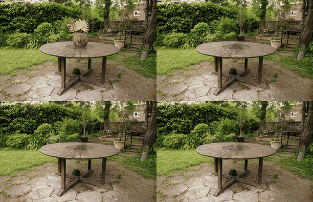
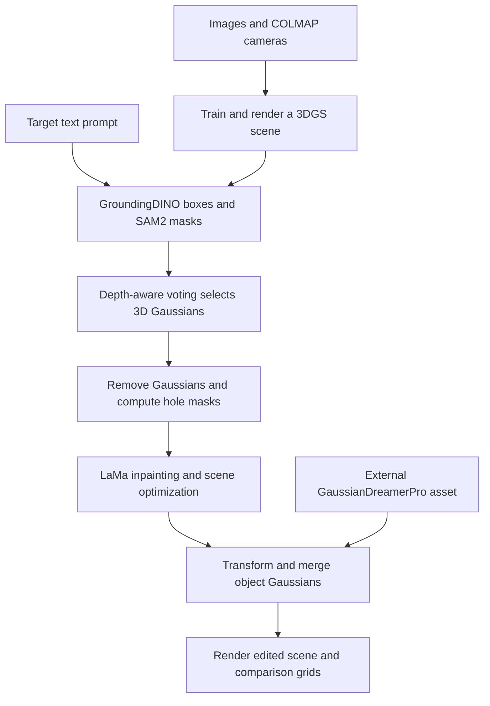
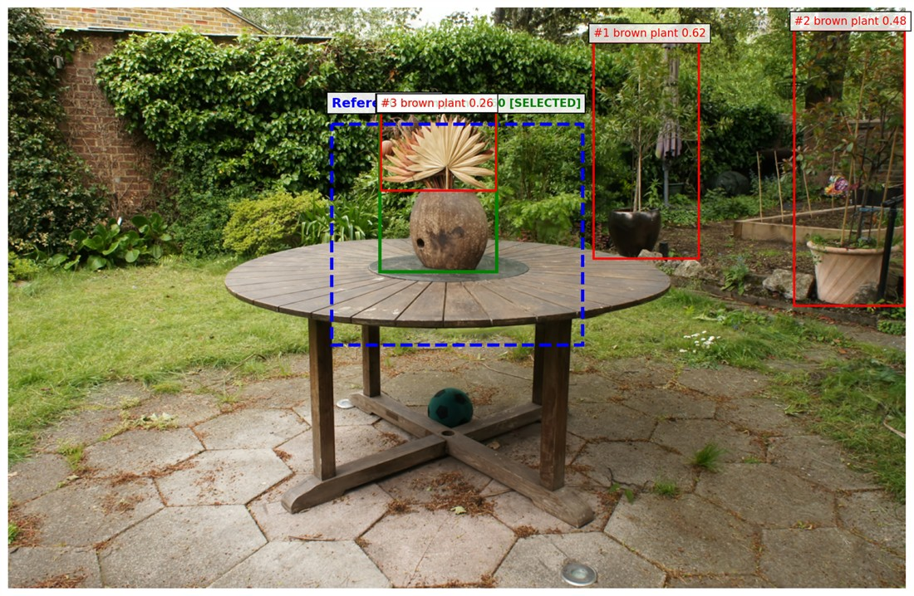
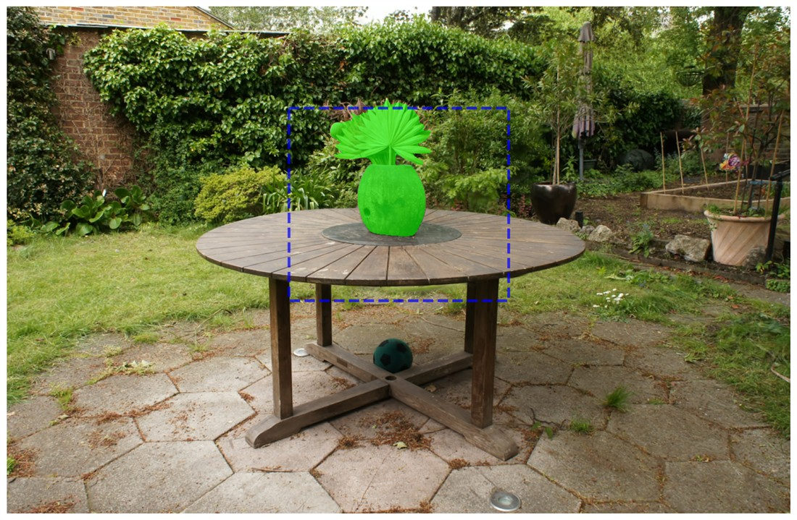
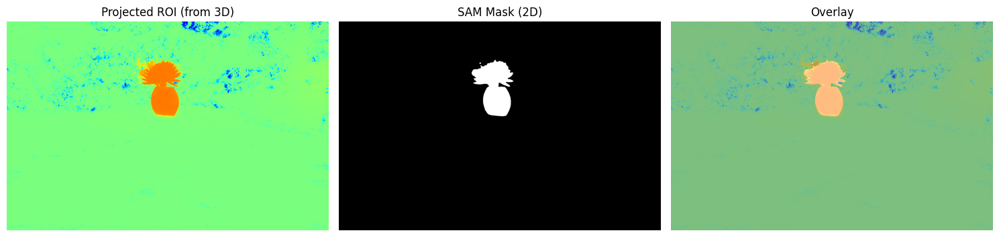
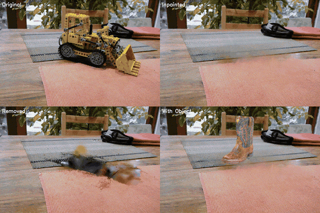

# 3D Scene Editing with 3D Gaussian Splatting

**Select an object with text, remove it from a reconstructed scene, restore the background, and insert a generated 3D asset.**

This project explores text-guided editing of real-world scenes represented as 3D Gaussian Splatting (3DGS). It connects **gsplat, GroundingDINO, SAM2, LaMa, and GaussianDreamerPro** into a pipeline that edits Gaussian parameters and renders the result from multiple viewpoints.

The central challenge is connecting a text description to the right 3D volume. A 2D mask can accidentally select background geometry, deleting visible Gaussians can leave internal density behind, and a generated object can look out of place in a captured scene. The experiments below show both the editing workflow and these remaining limitations.



*Garden experiment: replace the brown plant with a generated coffee cup. In this animation, the panels are **original** (top left), **inpainted and optimized** (top right), **removed before restoration** (bottom left), and **with inserted object** (bottom right). The cup is small at this scene scale.*

[Workflow](#how-it-works) · [Visual walkthrough](#visual-walkthrough) · [Limitations](#findings-and-limitations) · [Setup](#setup) · [Run the pipeline](#run-the-pipeline)

## Project overview

Rather than independently editing every training image and rebuilding the scene, this implementation selects and removes Gaussians in 3D. Inpainted 2D views then provide targets for refining the remaining scene. New objects are generated separately as Gaussian assets and merged into the edited checkpoint.

The project combines three main operations:

- **Object selection:** text-based detection and segmentation across views, followed by depth-aware voting to select scene Gaussians.
- **Scene restoration:** removal of selected Gaussians, depth-based hole masks, LaMa inpainting, and optimization against the inpainted views.
- **Object insertion:** transformation and merging of an externally generated Gaussian object, with scale and position controlled by the scene configuration.

This is a research prototype. Text drives object selection; the supplied experiments also use scene-specific thresholds, optional spatial guidance, and manual placement parameters.

## How it works



| Stage | Implementation | What it produces |
| --- | --- | --- |
| Reconstruct | `00_check_dataset.py`, `01_train_gs_initial.py`, `02_render_training_views.py` | Validated camera data, a trained scene checkpoint, and rendered training views |
| Detect and segment | `03_ground_text_to_masks.py` | GroundingDINO boxes, SAM2 masks, and overlays for the target text |
| Lift masks into 3D | `04a_lift_masks_to_roi3d.py`, optional `04b_visualize_roi.py` | Per-Gaussian region-of-interest (ROI) weights and projection diagnostics |
| Remove | `05a_remove_and_render_holes.py` | A checkpoint with selected Gaussians deleted, holed renders, and inpainting masks |
| Restore | `05b_inpaint_holes.py`, `05c_optimize_to_targets.py` | LaMa targets and an optimized scene checkpoint |
| Insert | `06_place_object_at_roi.py` | A merged checkpoint containing the edited scene and replacement object |
| Visualize | `07_final_visualization.py` | Final renders, four-panel comparisons, a summary grid, and image-difference metrics |

### Selecting the right Gaussians

For each camera, the lifting stage projects Gaussian centers into the image and compares their depth with the rendered depth. Only Gaussians passing the visibility check receive mask votes. Their ROI weight is the average mask value across views in which they pass that check.

The implementation uses a relative depth tolerance of `0.05 * max(rendered_depth, 0.1)`. This helps reject background Gaussians that project inside the object's silhouette. A scene-specific threshold turns the accumulated weights into a selection for removal.

### Restoring the background

An object represented by Gaussians can contain several overlapping layers. Deleting part of that volume may expose more density, so opacity differences alone can miss the area that needs repair.

The removal stage renders depth for the full scene and for the selected ROI. It marks pixels where the ROI is visible and lies at the front of the scene:

```text
hole_mask = (ROI_alpha > 0.1) AND (abs(full_depth - ROI_depth) < 0.01)
```

The depth threshold is in scene coordinates. This mask identifies the visible target footprint; it does not guarantee that all target Gaussians were selected.

LaMa fills these masked regions in each view. The optimization stage then updates the remaining Gaussian parameters to match those targets using an L1 rendering loss. Densification is disabled in the current implementation.

### Adding a new object

GaussianDreamer/GaussianDreamerPro runs separately in the supplied notebooks. The placement stage loads an exported `.ply` or `.pt` asset, centers it, applies scale and translation relative to the ROI bounds, and merges its Gaussian parameters into the restored scene. A command-line option also supports rotation around the Z axis.

## Visual walkthrough

### From text to an object mask

In the Garden scene, the prompt `brown plant` can match several plants. A configured reference box helps select the plant on the table; SAM2 then refines the detection into a pixel mask.

| GroundingDINO detections and spatial guidance | SAM2 segmentation |
| --- | --- |
|  |  |

### From a 2D mask to a 3D region



*The projected ROI is compared with the SAM mask to inspect whether the selected 3D region covers the intended object. This is a diagnostic view, rather than proof of complete volumetric removal.*

### A harder case: Kitchen



*Kitchen experiment: remove the yellow toy, called `yellow tracker toy` in the configuration, and insert a generated cowboy-boot asset. The panel layout matches the Garden animation. Residual geometry is especially visible in the lower-left panel, and the inserted asset's appearance differs from the captured scene.*

| Scene | Selection prompt | Replacement asset | Main observation |
| --- | --- | --- | --- |
| Garden | `brown plant`, with reference-box guidance | `coffee_cup_pro.ply` | Demonstrates selection, removal, restoration, and insertion across viewpoints |
| Kitchen | `yellow tracker toy`, without a reference box | `cowboy_boots_pro.ply` | Exposes selection failures on thin geometry, removal remnants, and appearance mismatch |

The five visuals above were selected from the final presentation. Smaller previews are stored in [`assets/readme/`](assets/readme/). The README animations use reduced resolution, frame rate, and color palettes to keep download sizes smaller.

## Findings and limitations

- **Selection depends on the scene.** The Garden experiment benefits from spatial guidance. In the Kitchen experiment, clutter and thin toy geometry make clean separation difficult, leaving residual artifacts.
- **Inpainting does not enforce agreement between views.** LaMa supplies background texture targets, but independent 2D completion can still disagree across cameras. Optimizing a shared 3D representation does not guarantee a correct reconstruction of the hidden background.
- **Generated assets need appearance integration.** The inserted objects can have a different style or baked-in lighting. The current placement stage does not solve relighting, contact shadows, or material matching.
- **Placement requires tuning.** Object scale and XYZ offsets are configured manually; the pipeline does not infer a physically grounded placement automatically.
- **The results are qualitative demonstrations.** The final visualization script computes MSE, PSNR, and a simplified global SSIM between original and edited renders. These differences do not directly measure whether an intended edit succeeded, and the configured CLIP/LPIPS metrics are not implemented there.

The presentation also reports that SDXL sometimes introduced unwanted objects during background completion, motivating the use of LaMa. The current checkout includes the LaMa implementation; it does not include the previously documented standalone SDXL inpainting script.

## Setup

The provided scripts target **Linux/Ubuntu with Bash**. On Windows, use a suitable CUDA-enabled WSL2 or Linux environment. Run commands from the repository root.

Prerequisites:

- An NVIDIA GPU and working CUDA support; memory requirements depend on scene size. The original project documentation reports experiments on RTX 2060 and RTX 4090 GPUs.
- Python 3.10+ with `venv` support, a CUDA toolkit compatible with the installed PyTorch build, and a C++ build toolchain for CUDA extensions. The setup script installs CUDA 12.1 PyTorch wheels when PyTorch is absent.
- `git`, `wget`, and `unzip`. FFmpeg is needed only for creating animations.

```bash
git clone https://github.com/jinyoonok2/3DCV-3D-Scene-Edit-with-3DGS.git
cd 3DCV-3D-Scene-Edit-with-3DGS

bash setup.sh
source activate.sh
```

[`setup.sh`](setup.sh) creates a local **`venv/`**, installs [`requirements.txt`](requirements.txt), clones gsplat into `gsplat-src/` for its dataset parsers, and runs `download.sh all`. It downloads model weights, the Mip-NeRF 360 dataset, and the shared GaussianDreamer assets. LaMa downloads its weights on first use. These downloads require network access and several GB of disk space.

The active setup uses Python `venv`. [`configs/environment.yml`](configs/environment.yml) is an alternative environment specification, rather than the environment created by `setup.sh`.

To request resource downloads separately after activating the environment:

```bash
bash download.sh models    # GroundingDINO, SAM2, and GroundingDINO config files
bash download.sh datasets  # Mip-NeRF 360 scenes
bash download.sh gdrive    # Shared, pre-generated GaussianDreamer assets
```

Before running the examples, check these inputs:

```text
datasets/360_v2/garden/       # Images and COLMAP reconstruction
datasets/360_v2/kitchen/
models/groundingdino_swint_ogc.pth
models/sam2_hiera_large.pt
GaussianDreamerResults/coffee_cup_pro.ply
GaussianDreamerResults/cowboy_boots_pro.ply
```

If shared assets are unavailable, generate or supply compatible object Gaussians and update `replacement.placement.object_gaussians` in the scene configuration. The supplied generation notebooks are [`Gaussian_Dreamer_pro_vastai.ipynb`](Gaussian_Dreamer_pro_vastai.ipynb) and [`GaussianDreamer_colab.ipynb`](GaussianDreamer_colab.ipynb).

## Run the pipeline

### Complete scene editing

After setup, activation, and input checks:

```bash
bash run_full_pipeline.sh configs/garden_config.yaml

# Or run the Kitchen experiment:
bash run_full_pipeline.sh configs/kitchen_config.yaml
```

The runner executes stages 00–07, including ROI visualization and object placement. It expects the replacement asset to exist before stage 06; it does not run the generation notebooks.

### Object removal without insertion

Run the stages through 05c and stop before object placement:

```bash
CONFIG=configs/garden_config.yaml
python 00_check_dataset.py --config "$CONFIG"
python 01_train_gs_initial.py --config "$CONFIG"
python 02_render_training_views.py --config "$CONFIG"
python 03_ground_text_to_masks.py --config "$CONFIG"
python 04a_lift_masks_to_roi3d.py --config "$CONFIG"
python 05a_remove_and_render_holes.py --config "$CONFIG"
python 05b_inpaint_holes.py --config "$CONFIG"
python 05c_optimize_to_targets.py --config "$CONFIG"
```

Stages can also be rerun individually while their input artifacts remain available. For example, after restoration, adjust placement and regenerate the final comparisons:

```bash
python 06_place_object_at_roi.py --config configs/garden_config.yaml \
    --scale 0.06 --xyz_offset 0.0 0.0 -0.06
python 07_final_visualization.py --config configs/garden_config.yaml
```

### Configuration

Use [`configs/garden_config.yaml`](configs/garden_config.yaml) or [`configs/kitchen_config.yaml`](configs/kitchen_config.yaml) as a starting point. Give a new experiment its own `project.name` so its outputs are separate.

| Setting | Purpose |
| --- | --- |
| `paths.dataset_root` | Images and COLMAP reconstruction for the scene |
| `segmentation.text_prompt` | Object to detect |
| `segmentation.reference_box` | Optional spatial guidance to disambiguate detections |
| `roi.threshold` | Threshold for selecting Gaussians for removal |
| `replacement.placement.object_gaussians` | Generated Gaussian object file |
| `replacement.placement.scale` | Uniform object scale |
| `replacement.placement.xyz_offset` | Translation relative to the selected ROI's bounding-box center |

**Configuration caveat:** stage 05c currently reads iteration and learning-rate settings from a top-level `optimization` section, whereas the supplied YAML files place them under `inpainting.optimization`. Use its CLI overrides, such as `--iters 500` or `--lr_means 8e-5`, when changing those values. Densification settings in the YAML do not enable densification in this stage.

### Outputs and animations

Outputs are organized under `outputs/<project.name>/`. For the Garden example:

```text
outputs/garden_brownplant_removal/
├── 01_initial_training/ckpt_initial.pt
├── 03_generated_masks/
├── 04_roi_extraction/roi.pt
├── 05_scene_editing/
│   ├── 05a_holed/ckpt_holed.pt
│   ├── 05b_inpainted/targets/train/
│   └── 05c_optimized/ckpt_patched.pt
├── 06_object_placement/merged_gaussians.pt
└── 07_final_visualization/
    ├── merged/
    ├── comparisons/
    ├── summary_grid.png
    └── metrics.json
```

With FFmpeg installed, [`create_animations.sh`](create_animations.sh) generates animations for **both** supplied scenes and expects their rendered outputs to exist. To animate only one experiment's four-panel comparisons:

```bash
ffmpeg -framerate 5 \
    -i outputs/garden_brownplant_removal/07_final_visualization/comparisons/%05d.png \
    -vf 'scale=960:-1' garden_comparison.gif
```

## Acknowledgments

This project builds on 3D Gaussian Splatting/gsplat, GroundingDINO, SAM2, LaMa, GaussianDreamer/GaussianDreamerPro, and the Mip-NeRF 360 dataset. It integrates these existing methods for scene-editing experiments; the limitations above describe where that integration remains incomplete.
